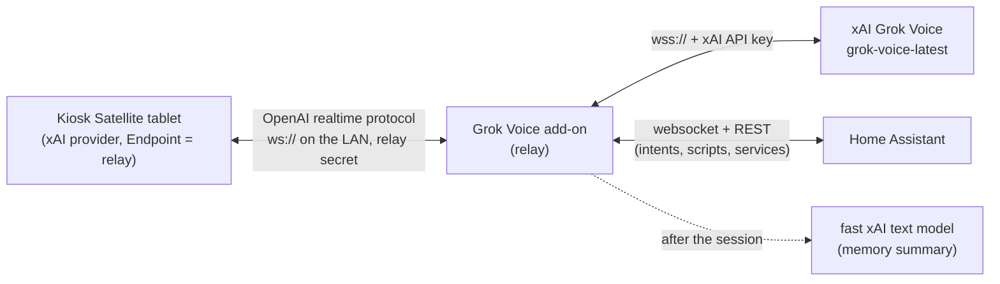

# Grok Voice Agent

**A realtime voice harness for [xAI Grok Voice](https://docs.x.ai/) in front of [Kiosk Satellite](https://kiosksatellite.com/) tablets, packaged as a Home Assistant add-on.**

Kiosk Satellite (KS) can talk to Grok Voice directly, but then every wake word ships a large Home Assistant tool list, a fixed 500 ms end-of-speech wait and default reasoning to xAI, and the tablet runs each tool call itself. This add-on sits in between as a relay: KS points its xAI **Endpoint** at the add-on, and the add-on decides what Grok sees (instructions, date, memory, tools), runs the tools next to Home Assistant, and streams only the answer back to the tablet.

Your xAI API key stays in the add-on. Tablets only hold a shared relay secret.

## Why

- **Latency.** Less to send, less to wait for: reasoning off, xAI's default end of speech instead of 500 ms of silence, about ten compact tools instead of ~58 (~54 KB), and tool calls answered on the Home Assistant host instead of by the tablet.
- **Control.** One place to decide what goes into a session: instructions, the current date and time, short-term memory, which tools are direct, and which live behind skills.

## How it works

1. The tablet connects to the relay and sends its usual `session.update`. The relay opens the xAI socket at the same moment (never before, so nothing is billed while idle).
2. The relay rewrites the session: it keeps KS's instructions (device and room), sets `reasoning.effort`, adjusts end-of-speech detection, adds the local date and time and recent context, and swaps KS's tool list for its own.
3. When Grok calls a relay tool, the relay runs it against Home Assistant and sends the result back to xAI. The tablet never sees the call, only the spoken answer. KS's own `end_conversation` still reaches the tablet.
4. After the session, the relay summarizes it in the background for the next one.

## Features

- **Session rewrite:** reasoning effort (none / high / default), end of speech (xAI default, KS's 500 ms, or a custom value), date and time injection (refreshed after midnight or ten minutes), extra instructions.
- **Built-in tools:** on/off, lights, covers and garage doors, locks, climate, fans, timers on the tablet, to-do lists and state lookup, run through Home Assistant intents. Only entities exposed to Assist are reachable; the tablet's device and room are used as defaults.
- **Skills with progressive disclosure:** one `skill` tool whose description is a one-line index per skill; `action=help` returns the full help and actions. Actions map to Home Assistant scripts, any service, a relay handler (media) or Home Assistant's own `script.skill`. Any skill can be promoted to a direct tool. Import from `script.skill` or from a JSON file.
- **Short-term memory:** per tablet (or house-wide), summarized by a fast xAI text model after each session, with tool calls kept verbatim and raw exchanges as the fallback.
- **Settings panel with live reload:** the Home Assistant sidebar opens on the relay panel (Status / Settings / Skills / Tablets). Changes apply to the next session without a restart; per-tablet overrides. The old browser mic UI is the **Test** tab.
- **Status view:** connected tablets, recent sessions with latency (end of speech to first audio) and tool timings, and each tablet's memory with a clear button.
- **Usage and cost estimates:** every session is recorded (tablet, start and end, duration, turns, tool calls with timings, latency median and p90 per session, ready time, and the token usage xAI reports), plus the summary model's tokens. The Status tab shows today / 7 days / 30 days totals split into realtime and summaries, cost and latency per tablet, a daily chart, and recent sessions with drill-down. Prices are configurable (default $0.08 per realtime minute); costs are estimates, not your xAI bill. Optional Home Assistant sensors: `sensor.grok_relay_cost_today`, `sensor.grok_relay_sessions_today`, `sensor.grok_relay_minutes_today`, `sensor.grok_relay_latency_median`.

## Measured latency

End of speech to first audio, medians, measured on one setup with a scripted client that behaves like KS (synthetic speech, same xAI account, from the same machine). Your numbers will differ.

| Utterance | KS direct to xAI (HA tool list, 500 ms VAD) | Through the relay |
| --- | --- | --- |
| "Turn on the attic lights." (one tool call) | 2.5 s | 1.0 s |
| "What is the capital of Australia?" | 1.8 s | 0.75 s |

## Requirements

- **Home Assistant OS** or **Supervised** (add-ons are not available on Container or Core)
- An [xAI API key](https://console.x.ai/) with Grok Voice
- **Kiosk Satellite** tablets with the realtime (xAI) provider
- Entities exposed to Assist for the built-in tools

## Setup

### 1. Install the add-on

1. In Home Assistant, open **Settings → Add-ons → Add-on store**.
2. Open the **⋮** menu, choose **Repositories**, add `https://github.com/fabianluque/ha-grok-voice` and save.
3. Install **Grok Voice Agent**. Home Assistant builds the image (the first install can take a few minutes).

### 2. Add-on options

| Option | What to set |
| --- | --- |
| **xAI API key** | Required. Used by the relay; never sent to a tablet. |
| **Kiosk Satellite relay secret** | A long random string. Setting it turns the relay on. |
| **Kiosk Satellite relay port** | Default `8766`. |

Start (or restart) the add-on. Everything else is set in the panel.

### 3. Each tablet (KS → Voice → Realtime → xAI)

| KS setting | Value |
| --- | --- |
| **Endpoint** | `ws://<ha-host>:8766/v1/realtime?model=grok-voice-latest` (optional `&device=<name>`) |
| **API key** | the relay secret |
| **Tools** | **None** (the relay brings its own) |
| **History** | its minimum (the relay keeps its own short-term memory) |

Then **Save & Validate**. `<ha-host>` is the Home Assistant host's LAN address or a name the tablet can resolve.

### 4. Tune it

Open **Grok Voice** in the sidebar (the relay panel is the landing page). Set or generate the relay secret on the Settings tab if you did not put one in add-on options. Details for every setting are in [DOCS.md](grok_voice_agent/DOCS.md#kiosk-satellite-realtime-relay-xai-endpoint).

## Security

- The xAI key stays in add-on options and is never sent to the panel or tablets. The relay secret can be set in add-on options or generated in the panel (shown once, then masked; never logged).
- The relay refuses every connection while the secret is empty and checks it on each connection (constant-time compare).
- Plain `ws://` is meant for your LAN only. Do not forward the relay port to the internet.
- The settings panel is only reachable through Home Assistant ingress (signed-in users), never on the LAN ports.
- Tools only reach entities exposed to Assist; skills only call the scripts and services you configure.

## Legacy: browser and injected duplex mode

The original mode still works: open **Grok Voice** in the sidebar and use the **Test** tab, or inject `grok-voice.js` into a Kiosk Satellite dashboard so the tablet runs its own duplex client against port `8080`. It uses Home Assistant's MCP server for tools and the browser-session options in the add-on configuration. See [DOCS.md](grok_voice_agent/DOCS.md) for setup and troubleshooting. New installs should use the relay.

## Troubleshooting

| Symptom | What to try |
| --- | --- |
| Store page is empty after you add the repository | Refresh the Add-on store and check the repository URL. |
| KS Save & Validate fails | Check the Endpoint host and port, that the API key field holds the relay secret, and the add-on log (`KS relay rejected a connection` means a wrong secret). |
| Tools say nothing matches | Expose the entities to Assist in Home Assistant. |
| Wrong room | Give the tablet's Home Assistant device an area. |
| Panel does not load | Open **Grok Voice** from the Home Assistant sidebar (ingress), not the LAN debug port. The panel shows the websocket close reason if it cannot load. |

Logs: add-on **Log** tab. The panel's **Status** tab shows each session's latency and tool calls.

## For maintainers

The version Home Assistant reads is `version` in `grok_voice_agent/config.yaml`. Git tags use the same number with a `v` prefix (`1.2.3` → `v1.2.3`).

Ship from GitHub. The workflow uses the built-in `GITHUB_TOKEN` only. Do not create an API key, and do not push the tag yourself.

1. Open **Actions → Release → Run workflow**.
2. Select branch **main**.
3. Choose a bump:
   - **current** — publish the version already in `grok_voice_agent/config.yaml`. Use this for the first release: nothing is tagged yet.
   - **patch**, **minor**, or **major** — write the next version into `config.yaml`, commit it on `main`, then publish.
4. Wait until the workflow is green. It will run pytest and the client tests, commit `config.yaml` / `CHANGELOG.md` when they changed, build amd64 and aarch64 images (`ghcr.io/fabianluque/grok-voice-agent`), push git tag `vX.Y.Z`, and create a GitHub Release.

Put `Fixes #N` (or `Closes #N`) in a pull request description so GitHub closes that issue on merge.

If **Release** cannot push to `main`, set **Settings → Actions → General → Workflow permissions** to read and write. Reload the add-on store after a publish so Supervisor sees the new `config.yaml` version.
